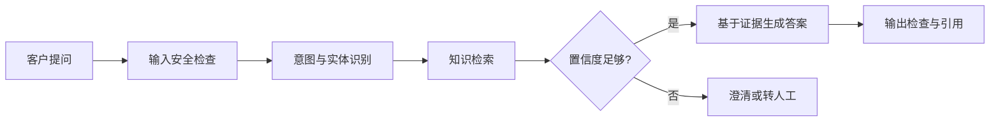
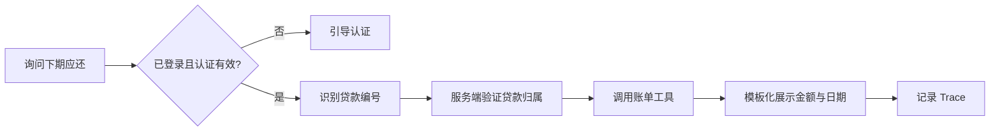
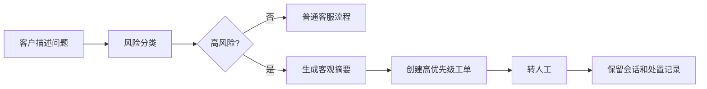

# 项目设计方案

## 1. 项目名称

中文名：小额贷智能客服 Agent

英文代号：Microloan Service Agent（MSA）

## 2. 背景与问题

传统小贷客服存在以下问题：

- 产品、利率、期限和业务规则较多，人工检索慢且容易使用旧版本知识；
- 客户需要在客服、贷款、账单和工单系统之间反复跳转；
- 传统关键词机器人无法理解多轮对话和口语化表达；
- 完全开放的大模型可能产生幻觉、越权查询或错误执行；
- 投诉、冒名贷款和隐私泄露等高风险问题需要快速转人工；
- 系统效果通常缺少可复现的评测方法。

## 3. 建设目标

### 3.1 用户目标

- 7×24 小时获得产品和流程解答；
- 登录后通过自然语言查询本人贷款业务；
- 遇到异常时快速创建工单并转接人工；
- 清楚知道回答依据、办理状态和后续动作。

### 3.2 工程目标

- 用确定性状态机约束 Agent 的执行路径；
- 用 RAG 提供带版本、有效期和权限的知识；
- 用工具调用连接模拟小贷核心业务；
- 在服务端完成身份与资源归属校验；
- 对模型、检索和工具调用进行完整追踪；
- 建立自动化评测集和版本回归门槛。

### 3.3 学习与求职目标

- 掌握 Spring AI 的模型与 Embedding，并实践不依赖模型 Tool Calling 的确定性业务动作编排；
- 掌握 Agent 状态、路由、记忆、失败恢复和人工接管；
- 将既有 Java 状态机、幂等、异步任务和安全经验迁移到 AI 应用；
- 形成可运行仓库、架构文档、测试报告和演示视频。

## 4. 系统角色

| 角色 | 权限与诉求 |
|---|---|
| 游客 | 查询公开产品、申请条件和办理流程 |
| 已登录客户 | 查询本人的申请、贷款、账单和还款记录 |
| 客服坐席 | 查看转接会话、客户摘要、推荐话术和关联工单 |
| 知识运营人员 | 上传、审核、发布、失效知识文档 |
| 合规人员 | 审核对客知识、风险规则和高风险会话 |
| 系统管理员 | 管理模型、工具、提示词、权限和运行配置 |

## 5. 业务范围

### 5.1 贷前服务

- 产品介绍、准入条件、申请材料；
- 期限、利率和费用的一般性解释；
- 申请入口、支持地区和办理流程；
- 风险提示与官方渠道识别。

### 5.2 贷中服务

- 申请进度查询；
- 缺失资料说明；
- 审批状态和合规原因码解释；
- 人工复核入口。

### 5.3 贷后服务

- 下一期账单和剩余本金查询；
- 历史还款记录；
- 扣款失败和还款未入账处理；
- 提前结清试算；
- 电子合同、还款计划和结清证明入口。

### 5.4 消保与投诉

- 识别违规催收、冒名贷款、隐私泄露和费用争议；
- 创建不同优先级的投诉工单；
- 保存必要的会话证据；
- 立即转人工或给出明确的处理时限。

## 6. 核心设计原则

1. **模型不是真实数据源**：金额、状态和日期必须来自业务 API。
2. **模型不负责授权**：用户身份来自 Spring Security，资源归属由服务端校验。
3. **模型不直接写库**：所有写操作通过白名单工具和领域服务完成。
4. **高风险场景人工优先**：投诉、隐私、冒名和协商类问题直接进入人工流程。
5. **回答必须可追溯**：保存知识版本、模型版本、提示词版本和工具调用结果。
6. **失败时安全降级**：无法确认就拒答或转人工，不猜测业务结果。
7. **最小必要数据**：不向模型传递与当前任务无关的客户敏感信息。

## 7. 关键业务流程

### 7.1 公开知识问答

### 7.2 本人账单查询

### 7.3 高风险投诉

## 8. 功能需求

### 8.1 客户聊天端

- 文本输入与 SSE 流式输出；
- 推荐问题和业务卡片；
- 登录/二次认证提示；
- 查看知识来源、工单号和处理状态；
- 随时转人工；
- 对答案点赞、点踩并填写原因。

### 8.2 客服工作台

- 接收机器人转接；
- 展示客户身份、关联贷款和对话摘要；
- 展示转接原因和已调用工具；
- 推荐话术但由坐席确认发送；
- 创建、更新和关闭工单。

### 8.3 知识管理

- 上传 Markdown、PDF 或结构化 FAQ；
- 解析、切分、向量化和发布；
- 配置产品、地区、版本、生效时间、访问范围；
- 审核后才能对客生效；
- 新版本发布后旧版本自动失效；
- 支持召回预览和错误反馈。

### 8.4 Agent 运营

- 查看一次请求的完整 Trace；
- 查看意图、风险、检索、工具和最终答案；
- 管理提示词和模型版本；
- 执行离线评测；
- 对比两个版本的准确率、延迟和成本。

## 9. 非功能需求

| 类型 | 目标 |
|---|---|
| 可用性 | 模型不可用时仍可转人工；业务查询失败不生成猜测答案 |
| 性能 | 普通知识问答 P95 首字响应小于 3 秒；业务查询 P95 完成小于 6 秒 |
| 安全 | 越权测试拦截率 100%；日志不保存明文证件号和银行卡号 |
| 准确性 | 工具选择准确率不低于 95%；高风险投诉召回率不低于 95% |
| 可审计 | 每次会话关联 traceId，保存模型、提示词、知识和工具版本 |
| 可维护 | 业务工具、Agent 节点和模型适配器低耦合，可独立替换 |
| 可移植 | 本地通过 Docker Compose 一键启动，模型供应商可配置切换 |

以上是项目验收目标，不代表真实生产系统指标。

## 10. 成功标准

- 五个演示场景可以稳定复现；
- 自动评测集不少于 150 条；
- 所有敏感查询均经过身份和资源归属校验；
- Agent 无法确认时能正确拒答或转人工；
- README 能在 15 分钟内指导面试官启动项目；
- 架构、测试报告和关键设计决策可以独立阅读。
