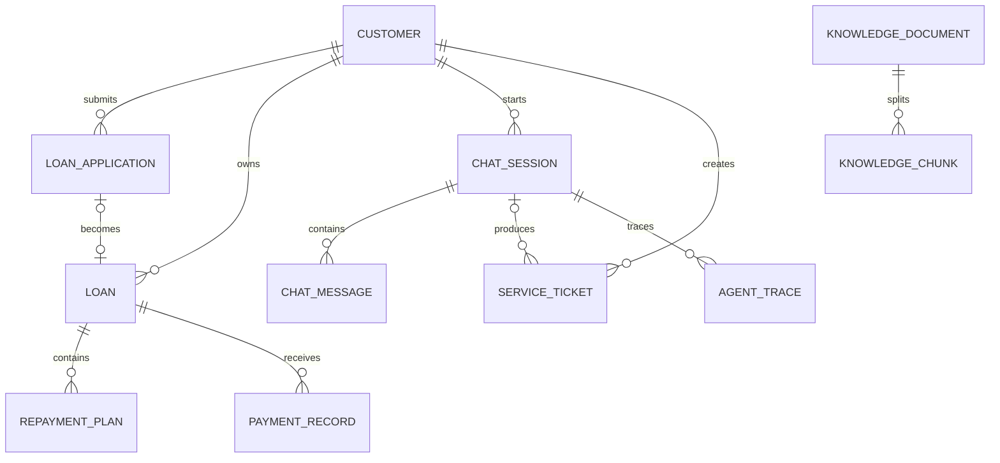

# 接口与数据模型

## 1. API 设计约定

- 基础路径：`/api/v1`；
- 认证：`Authorization: Bearer <token>`；
- 写接口接受 `Idempotency-Key`；
- 错误响应包含 `code`、`message`、`traceId`；
- 金额使用 `BigDecimal`，JSON 中使用字符串避免精度问题；
- 时间使用带时区的 ISO 8601 格式；
- 不向前端返回内部风控备注和数据库实体。

统一错误响应：

```json
{
  "code": "LOAN_ACCESS_DENIED",
  "message": "无法访问该贷款信息",
  "traceId": "01J6..."
}
```

## 2. 对话接口

### 2.1 创建会话

`POST /api/v1/chat/sessions`

响应：

```json
{
  "sessionId": "S202608310001",
  "status": "ACTIVE",
  "suggestedQuestions": [
    "申请经营贷需要什么材料？",
    "如何查询我的还款计划？"
  ]
}
```

### 2.2 发送消息

`POST /api/v1/chat/sessions/{sessionId}/messages`

```json
{
  "messageId": "M10001",
  "content": "我下个月要还多少钱？",
  "selectedLoanId": "L10001"
}
```

响应采用 SSE，事件类型：

- `status`：预定义处理状态；
- `answer_delta`：回答增量；
- `business_card`：账单或工单卡片；
- `auth_required`：需要认证；
- `handoff`：转人工；
- `completed`：包含 traceId；
- `error`：安全的错误说明。

禁止向客户发送模型思维链。`status` 只能是“正在查询账单”等预定义文案。

### 2.3 提交反馈

`POST /api/v1/chat/messages/{messageId}/feedback`

```json
{
  "rating": "DOWN",
  "reason": "OUTDATED_INFORMATION",
  "comment": "产品期限已经调整"
}
```

## 3. 业务接口

| 方法 | 路径 | 用途 |
|---|---|---|
| GET | `/customers/me/applications` | 查询本人申请列表 |
| GET | `/applications/{id}` | 查询申请详情 |
| GET | `/customers/me/loans` | 查询本人贷款列表 |
| GET | `/loans/{id}/next-repayment` | 查询下一期账单 |
| GET | `/loans/{id}/payments` | 查询还款记录 |
| POST | `/loans/{id}/settlement-quotes` | 提前结清试算 |
| POST | `/tickets` | 创建客服工单 |
| GET | `/tickets/{id}` | 查询本人工单 |

所有资源接口同时校验当前用户和资源归属。前端传入的 customerId 不作为授权依据。

## 4. Agent 工具契约

### 4.1 查询下一期账单

模型参数：

```json
{
  "loanId": "L10001"
}
```

工具内部从 SecurityContext 获取 customerId，并返回：

```json
{
  "loanId": "L10001",
  "dueDate": "2026-09-15",
  "principal": "1200.00",
  "interest": "62.50",
  "fee": "0.00",
  "totalAmount": "1262.50",
  "status": "PENDING"
}
```

### 4.2 提前结清试算

输入：

```json
{
  "loanId": "L10001",
  "settlementDate": "2026-09-03"
}
```

输出：

```json
{
  "quoteId": "Q10001",
  "remainingPrincipal": "8200.00",
  "interest": "33.70",
  "fee": "0.00",
  "totalAmount": "8233.70",
  "validUntil": "2026-09-03T23:59:59+08:00",
  "notice": "该结果仅为试算，不代表已经结清"
}
```

### 4.3 创建工单

输入：

```json
{
  "type": "PAYMENT_NOT_POSTED",
  "loanId": "L10001",
  "summary": "客户反馈已还款但账单状态尚未更新"
}
```

幂等键由 `customerId + conversationId + type + relatedResourceId` 生成或校验。

## 5. 领域模型



## 6. 核心表

### 6.1 customer

| 字段 | 类型 | 说明 |
|---|---|---|
| id | bigint | 主键 |
| customer_no | varchar | 对外客户编号，唯一 |
| name | varchar | 模拟姓名 |
| mobile_cipher | varchar | 加密手机号 |
| mobile_mask | varchar | 展示掩码 |
| status | varchar | ACTIVE/LOCKED |
| created_at | timestamptz | 创建时间 |

### 6.2 loan_application

| 字段 | 类型 | 说明 |
|---|---|---|
| id | bigint | 主键 |
| application_no | varchar | 申请编号，唯一 |
| customer_id | bigint | 客户 |
| product_code | varchar | 产品编码 |
| status | varchar | 当前状态 |
| reason_code | varchar | 可披露原因码 |
| missing_documents | jsonb | 缺失资料 |
| updated_at | timestamptz | 更新时间 |

### 6.3 loan

| 字段 | 类型 | 说明 |
|---|---|---|
| id | bigint | 主键 |
| loan_no | varchar | 贷款编号，唯一 |
| customer_id | bigint | 归属客户 |
| application_id | bigint | 来源申请 |
| principal | numeric(18,2) | 借款本金 |
| annual_rate | numeric(10,6) | 年化利率 |
| term | int | 期数 |
| status | varchar | ACTIVE/SETTLED/OVERDUE |
| version | int | 乐观锁版本 |

### 6.4 repayment_plan

字段包括贷款、期次、应还日期、应还本金、利息、费用、实还金额和状态。唯一约束：`loan_id + period_no`。

### 6.5 payment_record

字段包括支付流水号、贷款、客户、金额、渠道、银行卡尾号、支付状态和支付时间。支付流水号唯一。

### 6.6 service_ticket

字段包括工单号、客户、会话、关联贷款、类型、优先级、摘要、状态、负责人和版本。幂等表或唯一业务键防止重复创建。

### 6.7 knowledge_document / knowledge_chunk

文档表负责版本、状态和审核信息；切片表负责正文、全文检索向量、Embedding、元数据和校验和。

示意：

```sql
CREATE TABLE knowledge_chunk (
    id BIGSERIAL PRIMARY KEY,
    document_id BIGINT NOT NULL,
    content TEXT NOT NULL,
    search_vector TSVECTOR,
    embedding VECTOR(1024),
    product_code VARCHAR(50),
    region VARCHAR(50),
    audience VARCHAR(20) NOT NULL,
    effective_from DATE NOT NULL,
    effective_to DATE,
    metadata JSONB NOT NULL DEFAULT '{}'::jsonb
);
```

Embedding 维度必须与实际模型一致，迁移脚本不能在模型未确定前写死生产值。

### 6.8 agent_trace

| 字段 | 说明 |
|---|---|
| trace_id | 全链路唯一标识 |
| session_id | 会话 |
| customer_mask | 脱敏客户标识 |
| node_name | 节点名 |
| input_summary | 脱敏输入摘要 |
| output_summary | 结构化结果摘要 |
| model_version | 模型版本 |
| prompt_version | 提示词版本 |
| latency_ms | 耗时 |
| token_usage | Token 用量 JSON |
| status | SUCCESS/FAILED/SKIPPED |

## 7. 状态机

### 7.1 贷款申请状态

```text
DRAFT → SUBMITTED → REVIEWING → APPROVED → DISBURSED
                         ├────→ REJECTED
                         └────→ PENDING_DOCUMENT → REVIEWING
```

### 7.2 工单状态

```text
OPEN → ASSIGNED → PROCESSING → RESOLVED → CLOSED
                  └──────────→ WAITING_CUSTOMER
```

每次迁移检查前置状态并记录操作人。Agent 只能创建工单，首版不能自行将投诉工单标记为已解决。

## 8. 错误码示例

| 错误码 | 处理 |
|---|---|
| AUTH_REQUIRED | 返回认证事件 |
| STEP_UP_AUTH_REQUIRED | 要求二次认证 |
| LOAN_ACCESS_DENIED | 拒绝并记录安全事件 |
| KNOWLEDGE_NOT_FOUND | 澄清或转人工 |
| TOOL_TIMEOUT | 不生成业务结论，转人工或稍后重试 |
| DUPLICATE_TICKET | 返回已有工单号 |
| MODEL_UNAVAILABLE | 降级到固定提示和人工入口 |

